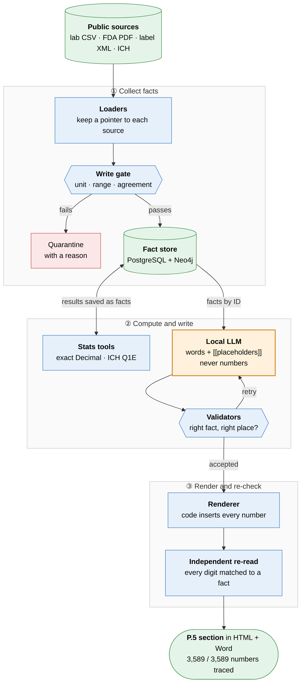

# eCTD Evidence Engine

**Drafting drug-approval dossier text where the AI never writes a number.**

Drug companies send regulators a huge dossier called the eCTD. Its quality part (Module 3, "CMC": chemistry, manufacturing and controls) is full of numbers: batch results, specification limits and impurity levels. Language models are good at fluent text, but they sometimes invent or misplace numbers. In a regulatory document, a single wrong digit is a serious error.

This project tests a different design:

> **The language model writes only words. Code owns every number.**
> Validated code computes each value from a fact store, where every fact points back to its source. The model writes prose with `[[placeholders]]`. A deterministic validator checks each draft, and then code fills in the numbers. An independent reader re-checks the final Word file.

This is a **portfolio and design project on public data**. It is not a validated GxP system, and it has not been used on a real submission.

---

## What it does today



**Orange** is the only step where the language model works. **Blue** steps are plain code with tests. **Green** is data.

It currently writes Module 3 section **3.2.P.5** (control of drug product): batch analyses (P.5.4), and specifications and their justification (P.5.1 and P.5.6).

## Results so far

These numbers come from the task records in [`STATE.md`](STATE.md), [`learn/STATE_ARCHIVE.md`](learn/STATE_ARCHIVE.md) and [`evidence/`](evidence/). Steps 2 and 3 under Setup let you reproduce the first and the Lek numbers yourself.

| Result | Number |
|---|---|
| Numbers in the generated P.5 document traced to a source "placement" | **3,589 / 3,589** in both HTML and Word, with 0 untraced digits |
| Planted-error (mutation) test of the validator | **9,816 / 9,816** planted errors caught across 33 error kinds, and **610 / 610** correct drafts accepted |
| Local LLM batch-analysis drafts (P.5.4, Gemma 4 E4B) | **130 / 130** accepted, 0 wrong |
| Local LLM specification drafts (P.5.6, real data) | **129 / 130** accepted, 0 wrong |
| Blind human review | Agreed 25 / 25. In a second sheet with 3 hidden wrong rows, caught 3 / 3 and agreed 22 / 22 |
| Claim checker on new, unseen overclaims | **10 / 10** flagged, and 0 false flags on the real document |
| Lek lab dataset loaded through the write gate | 4,965 facts accepted. 60 quarantined (20 batches broke an "impurity <= total" rule) |
| Shelf-life statistics | Match R's `expirest` package and NIST certified reference values |
| Automated tests | 643 passing on the author's PC (task T-059, 20 Nov 2026) |

## Built and tested vs only designed

**Built and tested (code and tests are in this repo):**
- Fact schema, write gate with quarantine, PostgreSQL fact store, and a Neo4j evidence graph with a drift check
- Loaders for the Lek lab dataset (CSV), the FDA Kerendia chemistry review (PDF, with page and box locations), and DailyMed label versions (XML)
- Statistics with exact `Decimal` maths: descriptive stats, ICH Q1E shelf life, poolability, out-of-trend limits and a below-LOQ policy
- Guideline knowledge layer: ICH chunking, hybrid search (full-text, embeddings and a reranker), word-for-word quote checks, and the ICH Q3B threshold table
- Writer for P.5.4 and P.5.6 with a local LLM, plus validators, an HTML and Word renderer, an independent re-read of the Word file, and a sentence-shape claim checker

**Designed but NOT built yet:**
- Hash-chained audit ledger and 21 CFR Part 11 e-signatures (`ectd_engine/ledger/` is an empty placeholder)
- Review UI, Word add-in, cross-module consistency checks, OCR of scanned documents (only a simulation exists in `ocr_stress_test/`), workflow orchestration and tracing, and other eCTD modules

The design documents (the Technical Brief and the Complete Explainer PDF) describe the full target system, including the parts that are not built yet.

---

## Setup

### What you need

| Tool | Needed for | Notes |
|---|---|---|
| **Python 3.12** | everything | Python 3.13 is **not** supported yet, because the pinned `scipy==1.13.1` has no 3.13 build |
| Git | getting the code | |
| Docker Desktop | database tests and loading data | runs PostgreSQL 16 with pgvector, and Neo4j 5.26 Community |
| [Ollama](https://ollama.com) | running the real writer and guideline search | models `gemma4:e4b` (writer) and `embeddinggemma` (embeddings) |
| R + the `expirest` package | 6 cross-check tests in `tests/test_r_crosscheck.py` | these tests fail on purpose, with "install R", if R is missing |

You can try the core demo (steps 1 to 3) with **only Python**, without Docker, Ollama or R.

The commands below are for Windows PowerShell. On macOS or Linux, use `source .venv/bin/activate` and `cp` instead of `copy`.

### 1. Get the code and install the libraries

```
git clone https://github.com/HilKalathiya/eCTD-Compilation-Audit-Platform.git
cd eCTD-Compilation-Audit-Platform
py -3.12 -m venv .venv
.venv\Scripts\activate
python -m pip install -r requirements.txt -r requirements-dev.txt
```

`requirements-dev.txt` adds `statsmodels` and `scipy`. The engine never imports them. The tests use them as an independent answer key.

### 2. Build the P.5 document and re-check it (no database, no model)

```
python tools/render_doc.py --out out/p5 --docx
python tools/reread_export.py out/p5 --out out/reread
```

The first command builds `P5.html` and `P5.docx` from the accepted model drafts saved in `evidence/`, and code inserts every number. The second command opens the saved Word file on its own and matches every digit to a placement. Expect:

```
numbers 3589
placements 3589
uncovered 0
reviewer flags 0 (see flags.csv)
RESULT docx numbers == placements
```

### 3. Read the public data without storing anything

```
python -m ectd_engine.loaders.lek --dry-run
python -m ectd_engine.loaders.fda_pdf --dry-run
python -m ectd_engine.loaders.dailymed --dry-run
```

The first loader should print `accepted 4965, quarantined 60 (20 batches)`. The other two print each fact with where it was found (a page and box, or an XML path) and `-> accepted`.

### 4. Start the databases

```
copy .env.example .env
```

Open `.env` and replace every `change-me...` value with your own password. `.env` is in `.gitignore`, so it is never committed. Then start the databases and create the tables:

```
docker compose --profile db --profile graph up -d --wait
python -m ectd_engine.db.migrate
```

`migrate` should print `migrations applied`, and it is safe to run again. Neo4j's browser is at http://localhost:7474 (user `neo4j`, with the password from your `.env`).

### 5. Run the tests

```
python -m unittest discover tests
python -m unittest discover tests_live
```

`tests/` holds the main suite. Without Docker, Ollama or R, most of it still passes. The rest fails with a message that names the missing service, such as "start Docker" or "install R". `tests_live/` always needs the databases.

### 6. Run the real writer with a local model (optional)

```
ollama pull gemma4:e4b
ollama pull embeddinggemma
python tools/writer_run.py --backend mock --out out/writer_mock
python tools/writer_run.py --kind p54 --model gemma4:e4b --out out/writer_p54
```

This step doesn't need the databases. The `mock` backend checks the whole loop without a model, and should print `8/8 accepted`. With Ollama running, `--kind p54` or `--kind p56` drafts real sections. Expect a few minutes per run on a 16 GB laptop. The guideline reranker (`mixedbread-ai/mxbai-rerank-base-v1`) is downloaded by `sentence-transformers` the first time it is used.

### Shut down

```
docker compose --profile db --profile graph down
```

Don't add `-v`, because that deletes the database volumes.

---

## Repository map

| Path | What it is |
|---|---|
| `ectd_engine/` | The engine: `loaders/`, `gate/`, `facts/`, `db/`, `graph/`, `stats/`, `knowledge/`, `rules/`, `specs/`, `writer/`, `validator/`, `render/`, `review/` and `ledger/` (empty placeholder) |
| `tests/`, `tests_live/` | Unit tests, and live database tests |
| `tools/` | Command-line tools: rendering, re-reading, the writer runner, replay, and the `watch.py` work monitor |
| `data/public/` | Public source files. [`SOURCES.md`](data/public/SOURCES.md) lists each URL, download date and SHA-256 |
| `Laboratory.csv` | Lek Pharmaceuticals production data (Scientific Data 2022, figshare, CC BY 4.0) |
| `evidence/` | Saved outputs and logs for each task (T-039 onwards), which the results above come from |
| `writer_test/`, `checks_stress_test/`, `ocr_stress_test/` | Early experiments that shaped the design (frozen) |
| `docs/requirements.md` | User requirements and risks, each linked to a test |
| `*Technical Brief*`, `*Complete Explainer*.pdf` | Design documents for the full target system |

### How it was built

The project was built with an AI-assisted workflow. The author wrote a numbered task spec for each step (T-001 to T-059), each with acceptance tests. An AI coding assistant (Claude Code) did the implementation. The author then checked the results with independent test output before accepting each one. These files are part of that process:

| Path | What it is |
|---|---|
| `CLAUDE.md`, `.claude/` | Instructions, hooks and rules for the coding assistant |
| `tools/watch.py` | Logs every file the assistant touches. It flags out-of-scope edits, weakened or deleted tests, new dependencies and possible secrets |
| `STATE.md` | Running log of finished tasks, newest first |
| `learn/` | Short plain-English notes written after each task |
| `handoff/` | Planning notes and the master plan from the start of the project (snapshot of 28 Oct 2026) |
| `Claude outputs/` | Early research notes, such as model choice and costs |

## Data and licence

Only public data is used: the Lek production dataset (CC BY 4.0), FDA Drugs@FDA and DailyMed documents for Kerendia (finerenone), NIST StRD reference datasets, and ICH guidelines. See [`data/public/SOURCES.md`](data/public/SOURCES.md).

The code is under the [MIT licence](LICENSE). Copyright (c) 2026 Hil Kalathiya.
